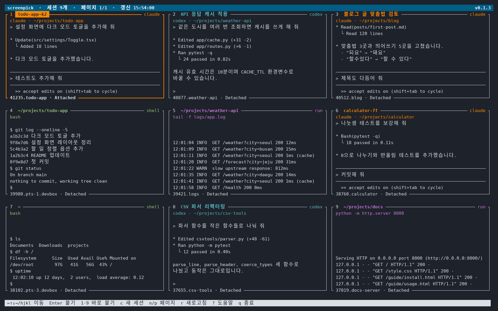

# screenpick

[](https://github.com/mystous/screenpick/actions/workflows/test.yml)
[](LICENSE)


[](https://claude.com/claude-code)

GNU `screen` 세션들을 **작은 썸네일 그리드**로 한눈에 보고, 골라서 바로 붙는(attach) 터미널 유틸리티입니다.

`screen -ls` 는 `12345.pts-0.myhost (Detached)` 같은 목록만 보여 줘서, 세션이 많아지면 어느 게 어느 작업인지 알기 어렵습니다.
screenpick 은 각 세션의 **실제 화면**을 작게 보여 주고, **Claude Code / Codex 세션이면 대화 제목을**, 일반 셸이면 **현재 디렉터리**를 제목으로 붙여 줍니다.



<sub>화면 예시는 가짜 세션으로 만든 것입니다 (`tools/screenshot.py`).</sub>

## 목차

- [기능](#기능)
- [요구 사항](#요구-사항)
- [설치](#설치)
- [사용법](#사용법)
- [설정 (환경변수)](#설정-환경변수)
- [동작 원리](#동작-원리)
- [프로젝트 구조](#프로젝트-구조)
- [개발](#개발)
- [기여하기](#기여하기)
- [버전 히스토리](#버전-히스토리)
- [알려진 제한](#알려진-제한)
- [Claude 로 만든 프로젝트입니다](#claude-로-만든-프로젝트입니다)
- [기여자](#기여자)
- [라이선스](#라이선스)

## 기능

- **썸네일 그리드**: 각 세션의 현재 화면 중 가장 최근(아래쪽) 부분을 작게 보여 줍니다. 한글 등 전각 문자도 깨지지 않습니다.
- **똑똑한 제목**
  - **Claude Code 세션**: 세션 이름(`/rename` 으로 붙인 이름 등)
  - **Codex 세션**: 스레드 제목. 대화가 아직 없는 새 세션은 `codex (새 대화)`
  - **일반 셸**: 셸의 현재 디렉터리(pwd). 셸에서 다른 프로그램(`vim`, `npm run dev` 등)이 돌고 있으면 그 명령도 표시
- **페이징**: 타일 수는 터미널 크기에 맞춰 자동으로 정해지고, 넘치면 페이지로 나눕니다.
- **바로 붙기**: `Enter` 또는 `1`~`9` 한 번으로 붙고, 세션에서 `Ctrl-a d` 로 떼어 내면 다시 그리드로 돌아옵니다.
- **새 세션 만들기**: `c` 를 누르고 이름을 입력하면(한글 가능, 비우면 screen 이 자동으로 정함) 새 세션을 만들어 바로 붙습니다.
- **자동 새로고침**: 보이는 페이지의 세션만 주기적으로 다시 캡처합니다.
- **스크립트용 목록 출력**: `screenpick --list`
- **설정은 전부 환경변수**: [The Twelve-Factor App](https://12factor.net/ko/) 원칙을 따릅니다.

## 요구 사항

- Linux (`/proc` 파일시스템을 사용합니다. macOS 는 지원하지 않습니다)
- Python 3.10 이상
- GNU screen (4.x 에서 확인)
- `setsid` (util-linux, 대부분의 배포판에 기본 포함)

## 설치

### uv 로 설치 (권장)

```bash
uv tool install git+https://github.com/mystous/screenpick.git
```

### pipx 로 설치

```bash
pipx install git+https://github.com/mystous/screenpick.git
```

### 소스에서 설치

```bash
git clone https://github.com/mystous/screenpick.git
cd screenpick
python3 -m venv .venv
.venv/bin/pip install -e .
.venv/bin/screenpick
```

설치하면 `screenpick` 명령이 생깁니다. 짧게 쓰고 싶으면 `~/.bashrc` 에 alias 를 추가하세요.

```bash
alias sp=screenpick
```

### 제거

```bash
uv tool uninstall screenpick    # 또는 pipx uninstall screenpick
```

## 사용법

```bash
screenpick                 # 그리드 화면
screenpick --list          # 목록만 텍스트로 출력 (종류, 세션 id, 상태, 제목)
screenpick --list --peek   # 각 세션 화면의 마지막 몇 줄까지 출력
screenpick --version
```

`--list` 출력 예:

```
claude  12345.pts-0.myhost               Detached   로그인 버그 수정
codex   12301.api                        Detached   API 문서 정리
program 12288.dev                        Detached   ~/work/webapp
shell   12250.logs                       Attached   /var/log
```

### 키

| 키 | 동작 |
|---|---|
| `←` `↑` `↓` `→` / `h` `j` `k` `l` | 타일 이동 (좌우 끝에서는 이전/다음 페이지로 넘어감) |
| `Enter` / `Space` | 선택한 세션에 붙기 |
| `1` ~ `9` | 현재 페이지의 n번째 세션에 바로 붙기 |
| `n` `PgDn` `]` | 다음 페이지 |
| `p` `PgUp` `[` | 이전 페이지 |
| `g` `Home` / `G` `End` | 처음 / 마지막 세션 |
| `c` | 새 screen 세션 만들기 (이름 입력 후 `Enter`, 취소는 `Esc`) |
| `r` | 지금 새로고침 |
| 마우스 | 클릭으로 선택, 더블클릭으로 붙기 |
| `?` | 도움말 |
| `q` / `Esc` | 종료 |

### 타일 읽는 법

```
┌ 번호  제목 ──────────────────── 종류 ┐
│ 보조 정보 (프로그램 · 경로)          │
│ … 세션 화면의 마지막 부분 …          │
└ 세션 id · 상태 ──────────────────────┘
```

- 종류: `claude` `codex` `shell`(셸이 놀고 있음) `run`(셸에서 다른 프로그램 실행 중)
- 선택된 타일은 굵은 테두리로 표시됩니다.
- screenpick 을 screen 안에서 실행하면 자기 자신이 돌고 있는 세션은 `현재 세션` 으로 표시되고, 거기에는 붙지 않습니다.

### 새 세션

- `c` 를 누르면 아래 줄에 이름 입력 칸이 나옵니다. `Backspace` 로 지우고, `Ctrl-U` 로 전부 지웁니다.
- 공백과 `.` `/` `:` 는 쓸 수 없고, 이미 있는 이름도 거부합니다.
- 새 세션은 screenpick 을 실행한 디렉터리에서 시작합니다.
- screen 안에서 screenpick 을 실행해도 현재 세션의 창이 아니라 **별도의 새 세션**이 만들어집니다.

## 설정 (환경변수)

모든 설정은 환경변수로 합니다. 예시는 [`.env.example`](.env.example) 참고.

| 변수 | 기본값 | 설명 |
|---|---|---|
| `SCREENPICK_TILE_WIDTH` | `60` | 타일 최소 너비. 남는 폭은 타일끼리 나눠 가짐 |
| `SCREENPICK_TILE_HEIGHT` | `14` | 타일 높이 |
| `SCREENPICK_REFRESH_SEC` | `5` | 자동 새로고침 주기(초). `0` 이면 끔 |
| `SCREENPICK_CAPTURE` | `pty` | 화면 캡처 방식: `pty` / `hardcopy` / `off` |
| `SCREENPICK_CAPTURE_TIMEOUT` | `1.5` | 세션 하나 캡처 최대 시간(초) |
| `SCREENPICK_WORKERS` | `6` | 동시에 캡처할 세션 수 |
| `SCREENPICK_ATTACHED_MODE` | `steal` | 이미 다른 곳에 붙어 있는 세션에 붙을 때: `steal`(`screen -d -r`, 기존 연결을 뗌) / `share`(`screen -x`, 같이 붙음) |
| `SCREENPICK_RETURN_AFTER_DETACH` | `true` | 세션에서 떼어 내면 그리드로 돌아올지. `false` 면 screenpick 이 끝나고 screen 으로 바뀜 |
| `SCREENPICK_SINGLE_INSTANCE` | `true` | 새로 켜면 같은 사용자의 이전 screenpick 을 종료. 잊고 남겨 둔 screenpick 이 계속 screen 을 조회하는 것을 막음. `false` 면 여러 개를 함께 띄울 수 있음 |
| `SCREENPICK_SAFE_SYMBOLS` | `true` | `⎿` `✔` `—` 처럼 터미널·글꼴에 따라 2칸으로 그려져 타일 테두리를 밀어내는 기호를 `└` `v` `-` 같은 글자로 바꿔 그림. `false` 면 원래 글자 그대로 |
| `SCREENPICK_SCREEN_BIN` | `screen` | screen 실행 파일 |
| `SCREENPICK_CLAUDE_DIR` | `$CLAUDE_CONFIG_DIR` 또는 `~/.claude` | Claude Code 설정 디렉터리 |
| `SCREENPICK_CODEX_DIR` | `$CODEX_HOME` 또는 `~/.codex` | Codex 설정 디렉터리 |
| `SCREENPICK_LOG_LEVEL` | `WARNING` | 로그 수준. 로그는 stderr 로 나가며, 그리드 화면 중에는 모았다가 종료할 때 출력 |

예:

```bash
SCREENPICK_TILE_WIDTH=45 SCREENPICK_REFRESH_SEC=0 screenpick
```

## 동작 원리

### 1. 세션과 프로그램 찾기

1. `screen -ls` 로 세션 목록을, `screen -Q info` 로 각 세션의 창 크기와 현재 창 번호를 읽습니다.
   - 단, 다른 곳에 붙어 있는(Attached) 세션에는 screen 명령을 보내지 않습니다. screen 4.x 는 `-Q` 조회 결과를 붙어 있는 화면의 메시지 줄에도 띄워서 입력을 방해하기 때문입니다.
     대신 창 셸의 터미널 장치에서 크기를 읽고(`TIOCGWINSZ`), 가장 최근에 입력을 받은 창을 현재 창으로 봅니다.
2. `/proc` 에서 screen 서버 프로세스의 자식 중 환경변수 `WINDOW` 가 현재 창 번호와 같은 셸을 찾습니다.
3. 셸의 터미널 전경 프로세스 그룹(`tpgid`)으로 지금 화면을 차지한 프로그램을 알아냅니다.
4. 그 프로그램과 자식 중에 `claude` 또는 `codex` 가 있으면 AI 세션으로 봅니다.

### 2. 제목 찾기

| 종류 | 출처 |
|---|---|
| Claude Code | `~/.claude/sessions/<pid>.json` 의 `name` → 없으면 대화 기록(`~/.claude/projects/*/<sessionId>.jsonl`)의 `custom-title` / `ai-title` / `summary` |
| Codex | codex 프로세스가 열어 둔 `rollout-*.jsonl` 파일 이름에서 스레드 id 를 얻어 `~/.codex/state_*.sqlite` 의 `threads.title` 조회. 못 찾으면 이 codex 가 시작된 뒤 갱신된 같은 디렉터리 스레드 |
| 셸 | `/proc/<셸 pid>/cwd` |

> Claude Code 와 Codex 의 내부 파일 형식은 공개 API 가 아니라서, 두 도구가 업데이트되면 제목을 못 찾을 수 있습니다.
> 그럴 때는 `claude` / `codex` 로만 표시되고 나머지 기능은 그대로 동작합니다.

### 3. 화면 캡처

screen 4.x 의 `hardcopy` 명령은 detach 된 세션에서 UTF-8 문자의 상위 바이트를 버려서 한글·박스 문자가 **복원할 수 없게** 깨집니다.
그래서 기본 방식(`pty`)은 이렇게 합니다.

1. 세션 창과 **똑같은 크기**의 가상 터미널(pty)을 만들고
2. 그 안에서 `screen -x` 로 잠깐(약 0.3초) 같이 붙어
3. screen 이 새 display 에 다시 그려 주는 화면을 [pyte](https://github.com/selectel/pyte)(Python 터미널 에뮬레이터)로 렌더링한 뒤
4. 바로 떨어집니다.

크기가 같으므로 창 크기 변경(SIGWINCH)이 일어나지 않고, 세션 상태(Attached/Detached)도 그대로입니다.
아무 입력도 보내지 않습니다. 창 크기를 확인하지 못한 세션은 캡처를 건너뜁니다.
`SCREENPICK_CAPTURE=hardcopy` 로 바꾸면 붙지 않고 `hardcopy` 를 쓰지만, ASCII 가 아닌 글자는 `·` 로 보입니다.

## 프로젝트 구조

```
screenpick/
├── src/screenpick/
│   ├── cli.py        진입점, 인자 처리, 로그 처리
│   ├── config.py     환경변수 → Config
│   ├── screens.py    screen -ls / -Q info 파싱, attach 명령 구성
│   ├── instance.py   이전 screenpick 찾아 종료 (한 번에 하나만)
│   ├── procinfo.py   /proc 스냅샷, 창의 셸·전경 프로세스·터미널 크기, claude/codex 판별
│   ├── titles.py     Claude Code / Codex 세션 제목 조회
│   ├── capture.py    화면 캡처 (pty + pyte, hardcopy 대체)
│   ├── model.py      세션 → 표시용 SessionView
│   ├── textwidth.py  한글 등 전각 문자 폭 계산
│   └── tui.py        curses 그리드, 페이징, 백그라운드 갱신
├── tests/            pytest 단위 테스트
├── tools/screenshot.py  README 스크린샷 생성 (가짜 세션 사용)
├── docs/screenshot.png  README 스크린샷
├── .github/workflows/test.yml   GitHub Actions (Python 3.10 ~ 3.13)
├── .env.example      설정 예시
├── pyproject.toml
└── LICENSE           MIT
```

의존성은 [pyte](https://github.com/selectel/pyte) 하나이고 나머지는 Python 표준 라이브러리(`curses`, `pty`, `sqlite3`, `threading` 등)입니다.

## 개발

```bash
git clone https://github.com/mystous/screenpick.git
cd screenpick
python3 -m venv .venv
.venv/bin/pip install -e '.[dev]'
.venv/bin/pytest
```

`uv` 를 쓴다면:

```bash
uv venv && uv pip install -e '.[dev]' && .venv/bin/pytest
```

테스트는 실제 screen 세션 없이 돌아갑니다(파싱, 제목 조회, 레이아웃, 폭 계산 등).
화면을 직접 확인하려면 테스트용 세션을 몇 개 띄워 보세요.

```bash
screen -dmS demo-shell bash
screen -dmS demo-top bash -c 'top'
screenpick
```

README 의 스크린샷(`docs/screenshot.png`)은 실제 세션이 아니라 가짜 세션으로 그립니다. 화면을 바꿨다면 다시 만들어 주세요.

```bash
uv run --with pillow python tools/screenshot.py
```

## 기여하기

이슈와 풀 리퀘스트를 환영합니다.

1. 버그나 제안은 먼저 [Issues](https://github.com/mystous/screenpick/issues) 에 남겨 주세요. 가능하면 OS, Python·screen 버전, `screenpick --list` 출력을 함께 적어 주세요.
2. 저장소를 fork 하고 브랜치를 만드세요. (`git checkout -b fix/something`)
3. 코드를 고치고 `pytest` 가 통과하는지 확인하세요. 새 동작에는 테스트를 추가해 주세요.
4. 커밋 메시지는 무엇을 왜 바꿨는지 짧게 적어 주세요.
5. 풀 리퀘스트를 열어 주세요.

규칙:

- 설정은 환경변수(`SCREENPICK_*`)로 받고, 코드에 경로나 값을 박아 두지 않습니다 (Twelve-Factor).
- 새 의존성은 꼭 필요할 때만 추가합니다.
- 문서와 사용자에게 보이는 메시지는 한국어로 씁니다.
- AI 도구로 작성한 코드도 환영합니다. 커밋에 `Co-Authored-By:` 로 밝혀 주세요.

## 버전 히스토리

지금 쓰는 버전은 목록 화면 오른쪽 위나 `screenpick --version` 으로 확인할 수 있습니다.

### 0.1.3 (2026-11-06)

- 타일 테두리가 밀려서 깨지던 문제를 고쳤습니다. `⎿` `✔` `—` `●` 같은 기호는 표준으로는 1칸이지만, 글꼴에 없어 다른 글꼴로 대신 그리는 터미널에서는 2칸이 되어 뒤의 글자와 테두리를 밀어냈습니다. 이제 `└` `v` `-` `*` 처럼 폭이 확실한 글자로 바꿔 그립니다.
- `SCREENPICK_SAFE_SYMBOLS=false` 로 끌 수 있습니다.

### 0.1.2 (2026-11-06)

- screenpick 을 새로 켜면 같은 사용자가 이전에 켜 둔 screenpick 을 자동으로 종료합니다. 잊고 남겨 둔 screenpick 이나, 연결이 끊긴 채 서버에 남은 screenpick 이 계속 screen 을 조회하던 문제를 막습니다.
- 이전 screenpick 안에서 세션에 들어가 있었다면, 그 세션을 먼저 깔끔하게 detach 합니다.
- `SCREENPICK_SINGLE_INSTANCE=false` 로 끌 수 있습니다.

### 0.1.1 (2026-11-06)

- 다른 터미널에서 붙어 있는 세션에 `(41,55)/(188,55)+1024 +flow UTF-8 0(bash)` 같은 메시지가 몇 초마다 떠서 입력을 방해하던 문제를 고쳤습니다. screen 4.x 는 `-Q` 조회 결과를 붙어 있는 화면에도 띄우므로, 붙어 있는 세션에는 screen 명령을 보내지 않고 `/proc` 와 터미널 장치에서 창 크기를 읽습니다.
- 목록 화면 오른쪽 위에 버전을 표시합니다.

### 0.1.0 (2026-11-02)

- 첫 공개. screen 세션을 썸네일 그리드로 보고 골라서 붙기, Claude Code / Codex 세션 제목 표시, 페이지 넘기기.
- `c` 키로 새 screen 세션 만들기.

## 알려진 제한

- Linux 전용입니다 (`/proc` 사용).
- 세션 하나에 창이 여러 개면 **현재 창**만 보여 줍니다. 붙어 있는 세션은 현재 창을 추정하므로 가끔 틀릴 수 있습니다.
- 썸네일은 화면을 줄이는 게 아니라 왼쪽·아래쪽을 잘라서 보여 줍니다.
- 캡처하는 짧은 순간 동안 세션에 display 가 하나 더 붙습니다. 이걸 피하려면 `SCREENPICK_CAPTURE=hardcopy` 나 `off` 를 쓰세요.
- Claude Code / Codex 내부 파일 형식이 바뀌면 제목 찾기가 안 될 수 있습니다.

## Claude 로 만든 프로젝트입니다

screenpick 은 Anthropic 의 AI 코딩 도구 [Claude Code](https://claude.com/claude-code) 와의 대화로 만들었습니다.

- **사람(Kyunam Cho)**: 만들고 싶은 도구를 설명했고(screen 세션을 썸네일로 보기, AI 세션은 제목, 셸은 pwd, 페이징), 결과를 써 보며 고칠 점(헤더 색 등)을 알려 주었습니다.
- **Claude**: 환경 조사, 설계, 모든 소스 코드, 테스트, 이 README 를 작성했습니다. screen `hardcopy` 의 UTF-8 손실 문제를 찾아내고, pty + pyte 로 화면을 읽는 방식도 Claude 가 제안하고 구현했습니다.

모든 커밋에 `Co-Authored-By: Claude` 를 넣어서, GitHub 커밋 화면에 Claude 가 공동 작성자로 표시됩니다.
AI 가 쓴 코드이므로 중요한 환경에 쓰기 전에 직접 검토해 주세요.

## 기여자

| | 역할 |
|---|---|
| **Kyunam Cho** ([@mystous](https://github.com/mystous)) | 기획, 요구사항, 검토, 관리 |
| **Claude** (Anthropic, [Claude Code](https://claude.com/claude-code)) | 설계, 구현, 테스트, 문서 |

기여해 주신 분은 이 표에 추가해 드립니다.

## 라이선스

[MIT License](LICENSE) © 2026 Kyunam Cho

자유롭게 사용, 수정, 배포할 수 있습니다. 저작권 표시와 라이선스 문구만 함께 남겨 주세요.
